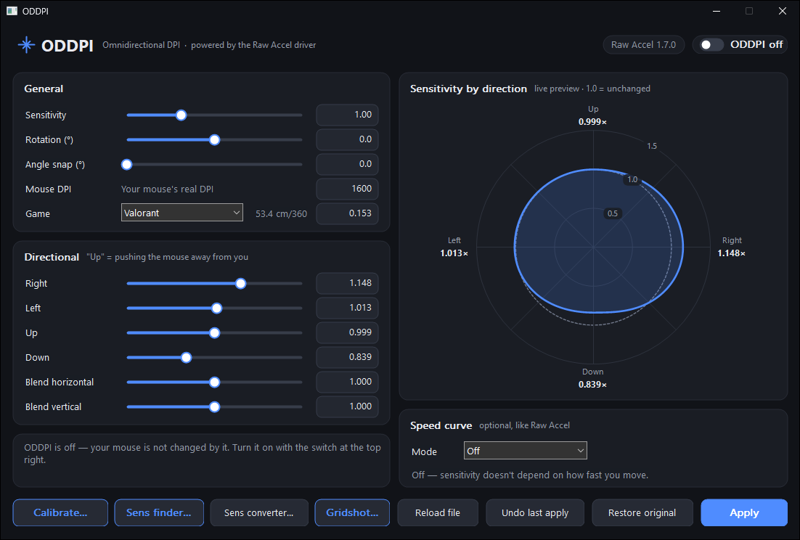
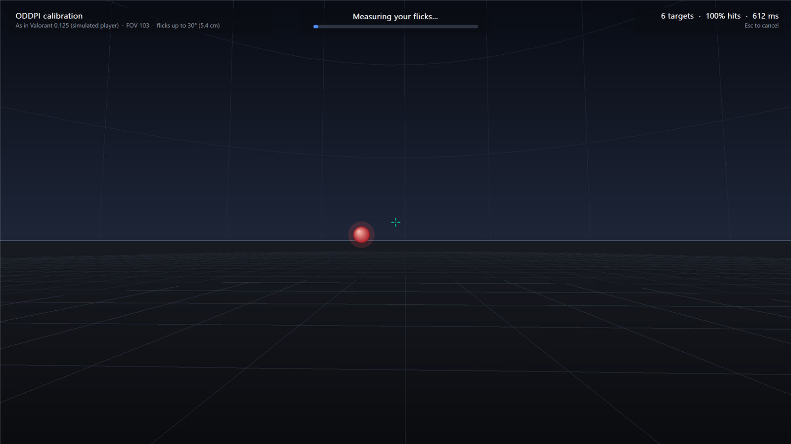
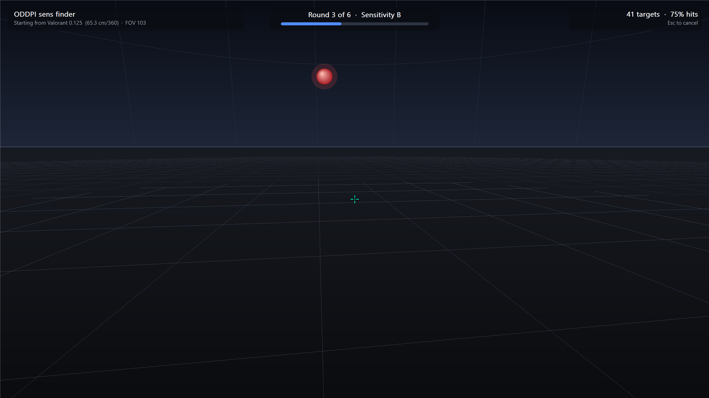
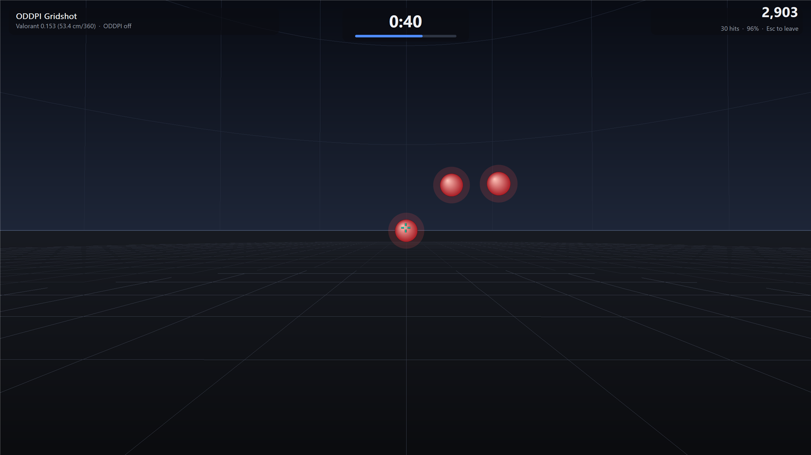
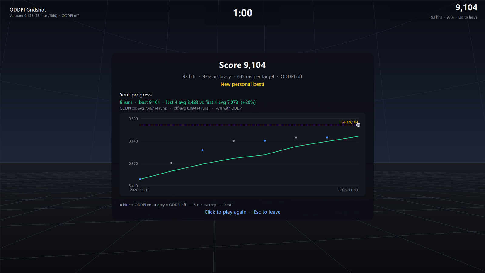

<div align="center">

# ODDPI — Omnidirectional DPI

**Per-direction sensitivity, rotation and speed curves for _any_ mouse, plus built-in aim tests that tune them for you.**

Like Razer's Mouse Rotation / Dynamic Sensitivity, but in software, for any mouse, and calibrated to how *you* aim.

[](#requirements)
[](https://github.com/RawAccelOfficial/rawaccel)
[](LICENSE)

[**Download**](../../releases/latest) · [Quick start](#quick-start) · [Features](#features) · [Command line](#command-line) · [How it works](#how-it-works) · [Building](#building)



</div>

---

## Why

Most people don't aim equally well in every direction. Wrist and arm anatomy make some flicks
overshoot and others fall short, and a slightly rotated grip adds a constant tilt. Gaming-mouse
firmware can fix some of this, but only on certain mice.

ODDPI measures how you actually flick in 16 directions, then sets a sensitivity for **right, left,
up and down** separately (and a rotation correction if you need one), so the same hand movement
lands in the same place whichever way you aim.

ODDPI **never touches mouse input itself**. It is a settings tool for the
[Raw Accel](https://github.com/RawAccelOfficial/rawaccel) driver, which is signed by Microsoft
and generally accepted by anti-cheat. The only thing in the input path is the official Raw Accel
driver.

## Features

- **Per-direction sensitivity**: separate `Right` / `Left` / `Up` / `Down` multipliers, with
  optional smooth blending by angle.
- **Rotation and angle snapping**: correct a tilted grip, or snap near-straight movement to
  perfectly straight.
- **Speed curves**: Classic, Natural, Jump, Power and Synchronous, with separate
  horizontal/vertical strength.
- **Live preview**: a polar diagram of sensitivity in every direction, computed with the
  driver's own math.
- **One-click on/off** in the header to turn ODDPI off instantly; every apply is backed up and can be undone.
- **3D calibration test**: flick to targets in your game's sensitivity and FOV, and ODDPI
  works out the corrections.
- **Sens finder**: blind A/B rounds that narrow down your best in-game sensitivity.
- **Gridshot with an improvement board**: a 60-second aim test that charts every run over time,
  including ODDPI on vs off.
- **Sens converter**: cm/360 and the matching sensitivity across games.
- **Sound effects** in all the aim tests (can be turned off).
- Dark and light theme, following Windows.

## Screenshots

<table>
<tr>
<td width="50%"><br><b>Calibration</b>: flick to each target; every click is one measured flick in one of 16 directions.</td>
<td width="50%"><br><b>Sens finder</b>: play sensitivity A and B blind; it moves toward the one you aimed better with.</td>
</tr>
<tr>
<td width="50%"><br><b>Gridshot</b>: three targets at a time, 60 seconds, score = hits × 100 × accuracy.</td>
<td width="50%"><br><b>Improvement board</b>: every run charted with a rolling average, personal best and ODDPI on/off comparison.</td>
</tr>
</table>

## Requirements

- Windows 10 or 11, 64-bit
- [Raw Accel](https://github.com/RawAccelOfficial/rawaccel/releases) **1.7.x** installed (run its
  `installer.exe`, then reboot)

ODDPI itself is portable: no installer, no runtime to install.

## Quick start

1. Install Raw Accel 1.7 and reboot.
2. Download `ODDPI-vX.Y.Z-win-x64.zip` from [Releases](../../releases/latest) and unzip it anywhere.
3. Run **`oddpi-gui.exe`**.
4. Type your **Mouse DPI**, pick your **Game** and type your in-game sensitivity.
5. Click **Calibrate…** and flick to the targets (about 3 minutes). Review the suggested
   values and confirm.
6. Click **Apply**. Use the **ODDPI on/off** switch at any time to compare.

Run calibration again later to refine it: each run corrects on top of the last.

## The settings window

`oddpi-gui.exe` edits `oddpi.ini` next to the exe (created if missing). It follows the Windows
dark/light app setting; set the environment variable `ODDPI_THEME=light` or `dark` to override.

- Sliders and boxes for every setting; the speed-curve section only shows the parameters the
  selected mode uses.
- A live diagram of sensitivity in every direction. In a speed-curve mode it shows three speeds.
- **Apply** saves the file and makes it live. **Undo last apply** and **Restore original** go back to
  earlier driver states.

## Aim tests

All tests run fullscreen in a 3D scene that uses your game's sensitivity and FOV, so every flick
is the same hand movement you make in game. They read raw mouse input only while their window is
open; they never hook, block or inject input. Press **Esc** to leave any of them.

### Calibration

`oddpi calibrate` or **Calibrate…**

1. It applies your current `oddpi.ini`, so the test measures exactly how your mouse feels.
2. Flick to each red target in one quick motion and click. After a 4-target warm-up it stops by
   itself once every correction is known to within about 4% (usually 50 to 100 targets, at most 132).
3. For every flick it measures the first, ballistic movement: how far it went compared to the
   target, and how far it was rotated. Directions you overshoot get a lower multiplier,
   directions you undershoot a higher one. A consistent tilt becomes a `Rotation` correction
   (ignored under 1°).
4. The 16 directions are fitted onto `Right` / `Left` / `Up` / `Down`, normalised so your overall
   sensitivity stays the same. Single flicks vary by 10 to 15%, so each correction's uncertainty is
   estimated (bootstrap) and corrections within the noise are shrunk toward 1.0 instead of
   chasing randomness.
5. You see the old and new values and confirm before anything is saved. The previous config is
   kept as `oddpi.ini.bak`.

Every run's raw flicks are saved to `%LOCALAPPDATA%\ODDPI\calibrations\*.csv`.
(`oddpi calibrate2d` runs the older 2D cursor test.)

### Sens finder

`oddpi sensfinder` or **Sens finder…**

Finds your best in-game sensitivity. Each round you play two sensitivities blind ("A" and "B",
alternating every 4 targets). It scores time per target with a penalty for misses, moves toward
the better one (further when the difference is clear) and narrows the range. Six rounds from half
to double your current sensitivity, about 100 targets. You can save the result to `oddpi.ini`;
you still need to set it in the game yourself.

### Gridshot

`oddpi gridshot` or **Gridshot…**

A 60-second "test your aim" mode: three targets on a grid at a time, and each hit spawns a new one.
Score = hits × 100 × accuracy. Every finished run is saved to `%LOCALAPPDATA%\ODDPI\gridshot.csv`
along with your sensitivity, your direction settings and whether ODDPI was on. The **improvement board**
after each run shows:

- every run over time, with a 5-run rolling average and your personal best
- your last few runs' average compared with your first few
- average score with ODDPI on vs off, so you can see whether your settings actually help

## Your game and sensitivity

Set the game you play and its in-game sensitivity (GUI: the Game row; CLI: `calibrate` asks, or
`[Game]` in `oddpi.ini`). Targets then sit at real view angles (up to about 35°) and the screen uses your
FOV (`FOV=`, default 103). You can also give `Cm360=` directly.

Built-in games: CS2, CS:GO, Apex Legends, TF2, Titanfall 2, Quake Champions, Valorant,
Overwatch 2, Call of Duty, plus community estimates for Fortnite and Marvel Rivals. Add or fix
games in `games.ini` next to the exe:

```ini
[My Game]
Yaw=0.022
Aliases=mg, mygame
Note=where the value comes from
```

The sens converter (`oddpi convert valorant 0.35` or **Sens converter…**) shows your cm/360 and
the matching sensitivity in every other game. It matches 360 distance only (no ADS/zoom or
FOV-dependent scaling).

## Settings reference

| Setting | What it does |
|---|---|
| `Rotation` | Rotates all movement (degrees, positive = clockwise on screen) |
| `AngleSnap` | Snaps near-straight movement to perfectly horizontal/vertical |
| `Right` / `Left` / `Up` / `Down` | Independent sensitivity per direction |
| `BlendHorizontal` / `BlendVertical` | Sensitivity that changes smoothly with angle, without bending direction |
| `Mode` = Classic / Natural / Jump / Power / Synchronous | Speed-based sensitivity curves |
| `HorizontalStrength` / `VerticalStrength` | How strongly the speed curve applies horizontally vs vertically |
| `[Trainer] Sound` / `Volume` | Sound effects in the aim tests (`true`/`false`, 0 to 1) |

Run `oddpi init` to create a fully commented `oddpi.ini`.

### Limits (from the stock Raw Accel driver)

- Diagonals follow from the per-axis settings; they can't be set separately.
- The angle blend is linear from 0° to 90° and mirrored into every quadrant.
- The blend and a speed curve can't be used together (they share one slot in the driver).
- Raw Accel adds a deliberate delay of about 1 second to every settings change.

## Command line

`oddpi.exe` does everything the window does, and more:

```
oddpi init                 create a commented oddpi.ini
oddpi preview              show what it does in every direction (changes nothing)
oddpi apply                back up current Raw Accel settings, then make oddpi.ini live
oddpi calibrate            3D flick test that evens out your aim in every direction
oddpi calibrate2d          the same with the older 2D cursor test
oddpi analyze [log]        re-run the analysis on a saved calibration log (changes nothing)
oddpi sensfinder           find your best in-game sensitivity
oddpi gridshot             60-second aim test with an improvement board
oddpi games                list known games and their yaw
oddpi convert <game> <sens> [to-game]   cm/360 and the same sens in other games
oddpi off                  turn ODDPI off (mouse back to normal; other Raw Accel profiles kept)
oddpi on                   turn it back on (same as apply)
oddpi status               show what the driver is currently running
oddpi restore              undo the last apply
oddpi restore original     go back to the settings from before ODDPI was first used
oddpi backups              list backups (%LOCALAPPDATA%\ODDPI\backups)
```

All commands take an optional config or backup path.

## How it works

ODDPI turns `oddpi.ini` into a Raw Accel profile named `ODDPI`, validates it with Raw Accel's own
validator, and writes it to the driver as the first (default) profile. Your other Raw Accel
profiles and device mappings are kept. Every apply is backed up first, and after writing, the
settings are read back and compared.

`oddpi preview` and the live diagram run Raw Accel's own transform code (`ra::modifier`), so they
show exactly what the driver will do.

The driver copies settings byte-for-byte, so ODDPI is built against the exact Raw Accel headers
(`third_party/rawaccel`, v1.7.0). If the installed driver's layout differs, ODDPI detects it and
refuses to write.

## FAQ

**Is it safe with anti-cheat?**
ODDPI only changes the settings of the Raw Accel driver; it doesn't run anything in the input path
itself. Raw Accel is Microsoft-signed and widely used. As with any input software, check your
game's rules; you use it at your own risk.

**Windows says "Windows protected your PC". Is it safe?**
That blue SmartScreen box appears for programs that aren't code-signed. Signing certificates cost
hundreds per year, so most small open-source tools don't have one. It doesn't mean anything was
detected. Click **More info**, then **Run anyway**. You only need to do this once per exe.

To check your download is genuine, compare its SHA-256 with the one on the release page. In
PowerShell, in the folder you downloaded to:

```
Get-FileHash .\ODDPI-v1.0.0-win-x64.zip
```

You can also build it yourself from this source code (see [Building](#building)).

**How do I turn it off?**
Click the **ODDPI on/off** switch, or run `oddpi off`. `oddpi restore original` returns the driver to
exactly how it was before you first used ODDPI.

**Where is my data?**
Settings live in `oddpi.ini` next to the exe. Backups, calibration logs and Gridshot history are
in `%LOCALAPPDATA%\ODDPI`. Nothing is sent anywhere.

## Building

Visual Studio 2026 (v145 toolset). Open `OpenSource ODDPI (OmnidirectionalDPI).slnx` and build
**Release | x64**, or from a developer prompt:

```
msbuild "OpenSource ODDPI (OmnidirectionalDPI).slnx" /p:Configuration=Release /p:Platform=x64
```

The output goes to `x64\Release\` (`oddpi.exe` and `oddpi-gui.exe`). Release builds link the C++
runtime statically, so the exes run without the Visual C++ Redistributable.

Self-tests (simulated players, no mouse needed): `oddpi selftest`, `oddpi selftest3d`,
`oddpi selftestsens`, `oddpi selftestgrid`.

## Credits and license

ODDPI is released under the [MIT License](LICENSE).

Built on [Raw Accel](https://github.com/RawAccelOfficial/rawaccel) by a1xd and contributors.
`third_party/rawaccel` contains unmodified Raw Accel headers under the MIT license (see
`third_party/rawaccel/LICENSE`).

ODDPI is not affiliated with Raw Accel, Razer, Aim Lab or KovaaK's. Game names are trademarks of
their respective owners.
